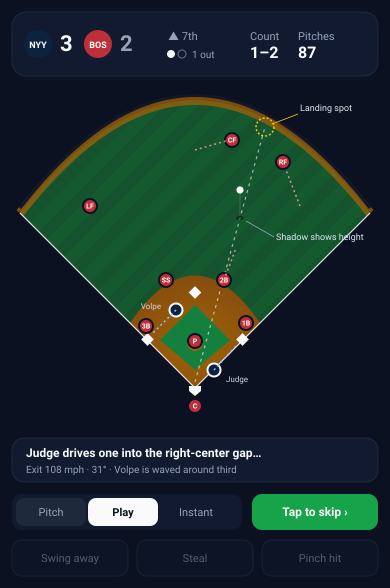

# Animated field: spec

A top-down field for the live game view that shows each play happening: pitch, contact, ball flight, fielders converging, runners moving. It should feel like watching the game, not a cartoon of it, while staying quick, readable on a phone and skippable at any moment.



## Goals

- **Readable at a glance on a 390px phone.** The field, score, count and outs are visible together without scrolling.
- **Fast by default.** A typical plate appearance plays out in 2–4 seconds. Tap anywhere to finish the current play instantly.
- **Adds understanding, not just motion.** You can see *why* a run scored: the ball found the gap, the runner was sent, the throw was late.
- **No new dependencies.** SVG plus the Web Animations API. It must run at 60fps on a mid-range phone and work offline.
- **Optional.** The current static diamond remains as "Instant" speed and as the reduced-motion fallback.

## What it looks like

| Element | Look |
|---|---|
| Field | Stylized top-down park: mowed grass stripes, dirt infield, warning track, wall. Fixed camera, no rotation. Scale ~0.75 px/ft so the whole park fits the width. |
| Fielders | Dots in the fielding team's primary color with position labels (P, C, 1B…). They start at their defensive positions and drift toward the ball. |
| Runners | Dots in the batting team's color with a white ring (shape differs, not only color), with a last-name tag. |
| Ball | A small white dot. Height is shown by lifting the ball above a shadow that stays on the ground, so fly balls read as fly balls from overhead. |
| Trail | A faint dashed ground track during the play; the landing spot pulses briefly. |
| Caption | One line under the field, written as the play unfolds ("Judge drives one into the right-center gap…"), then resolves ("…stand-up double, Volpe scores"). |
| Scoreboard | Score, inning, outs, count and pitch count, pinned above the field. |

Colors come from the existing team colors and theme tokens; dark mode is the primary look (night game), light mode gets a daytime palette.

## The plays

Every result the engine produces gets a short choreography. Timings below are at the default **Play** speed.

| Play | Choreography | Time |
|---|---|---|
| Pitch | Ball travels mound → plate; a tick shows ball or strike; count updates. Only shown at **Pitch** speed, except the final pitch of a PA. | 0.5s |
| Strikeout | Final pitch, catcher holds the ball, a "K" (or backwards K for looking) pops by the plate. | 0.8s |
| Walk / HBP | Batter trots to first; forced runners advance. | 1.0s |
| Ground out | Ball skips along the ground (shadow and ball together) to an infielder, who fields it and throws to first. Ball and runner race; the out marker lands on first. | 1.6s |
| Double play | Ground ball to SS/2B, flip to second (runner forced), relay to first. | 2.2s |
| Fly / line out | Ball rises (lifts off its shadow), fielder drifts under it, catch. Runners tag up and go if the engine says they advanced. | 1.8s |
| Single | Ball through the infield or into short outfield; outfielder fields and throws in to the cutoff; runners advance per the result. | 1.8s |
| Double / triple | Ball to the gap or down the line; outfielder chases to the wall; relay through the cutoff man; runners circle. | 2.4s |
| Home run | High arc over the wall, ball leaves the field; a brief team-color flash; batter and runners trot the bases (accelerated). | 2.6s |
| Steal | Runner breaks on the pitch, catcher throws to the base; safe or out at the bag. | 1.4s |
| Sac bunt | Ball dribbles a few feet; corner infielder charges; throw to first; runners advance. | 1.4s |
| Error | Like the matching out, but the ball squirts past the fielder; an "E6"-style tag appears. | 1.8s |
| Pitching change | Reliever dot jogs in from the bullpen beyond the outfield wall; brief name card. | 1.2s |

## Speeds and skipping

A three-way control under the field, remembered per device:

- **Pitch**: every pitch is shown (count builds up), then the play. Roughly 6–10s per plate appearance.
- **Play** (default): only the deciding pitch and the play. 2–4s per plate appearance.
- **Instant**: today's behavior: the static diamond updates with the result.

Tapping the field (or a "Tap to skip" button) finishes the current play immediately. **Sim inning** and **Sim to end** skip animation entirely and work as they do today. A setting can limit animation to key moments only (scoring plays, the 7th inning on, and your team's at-bats).

## Decisions stay in place

When the engine pauses for a decision (swing away, steal, bunt, pinch hit, pitching change), the field stays visible with the current defensive alignment and runners, and the decision tray sits below it. The tray is dimmed and disabled while a play is animating. Pitching changes and pinch hitters animate in before the next pitch.

## Engine work required

The engine currently reports each plate appearance as a result code plus a text line ("singles to right"). Animation needs a structured description of what happened, so the plan is to emit play events alongside the existing log. The text log can then be generated from the events.

```ts
interface PlayEvent {
  kind: 'pitch' | 'pa' | 'steal' | 'pitchingChange' | 'pinchHit';
  batterId?: number;
  pitcherId?: number;
  /** Cosmetic pitch sequence consistent with the result and pitch count. */
  pitches?: ('B' | 'S' | 'F' | 'X')[];
  result?: PaResult;
  battedBall?: {
    type: 'ground' | 'line' | 'fly' | 'popup' | 'bunt';
    /** Spray angle in degrees: -45 = third-base line, +45 = first-base line. */
    angle: number;
    /** Where it lands or is fielded, in feet from home. */
    distance: number;
    /** Peak height in feet (drives the ball-over-shadow lift). */
    apex: number;
    exitVelo: number;
    launchAngle: number;
  };
  /** Fielders who touch the ball, in order: 6 then 4 then 3 for a 6-4-3 double play. */
  fielders?: number[];
  /** Every runner's movement, including the batter. */
  runners: { playerId: number; from: 0 | 1 | 2 | 3; to: 1 | 2 | 3 | 4; out: boolean }[];
  error?: { fielder: number };
}
```

Generating the batted-ball details:
- The engine already decides the *result*. The geometry is drawn afterwards and constrained to match it: a single lands in front of an outfielder or through a hole, a double reaches a gap or a line, a ground out goes at an infielder.
- Spray angle leans to the batter's pull side (by handedness and a power tilt).
- Exit velocity and launch angle are sampled from distributions keyed to the result type and the batter's power.
- None of this changes outcomes. It's cosmetic, and it is seeded from the game RNG so replays look the same.
- Bonus: once events exist, box scores can store spray locations. That unlocks spray charts on player sheets and real defensive-positioning ideas later.

## Rendering

- An `AnimatedField` component renders the park as static SVG once, plus a layer of absolutely positioned dots animated with the Web Animations API (`element.animate`). No per-frame React renders.
- A small "director" turns a `PlayEvent` into a timeline of keyframes: ball path, fielder paths, runner paths, caption updates. A shared clock makes skip set every animation to its end state.
- Ball flight: the ground track is a straight line from home to the landing point. Height follows a parabola from `apex`, drawn as a vertical offset of the ball above its shadow.
- Runners move along the base paths (home→1B→2B→3B→home), never across the infield. Fielder speed and runner speed scale with their speed ratings, so a fast runner visibly beats a throw.
- Budget: fewer than 30 animated nodes, transforms and opacity only. Test on a throttled mid-range Android profile.

## Accessibility

- `prefers-reduced-motion`: default to Instant; plays resolve with a short fade and highlighted runner moves instead of motion.
- The text play-by-play remains, in an `aria-live` region, so screen readers get every play.
- Teams are distinguished by shape (ringed runners vs. solid fielders) as well as color.
- Nothing flashes more than once; the home run flash is a single soft pulse.

## Build plan

1. **Play events.** Emit `PlayEvent`s from the sim with generated geometry; derive the text log from them; unit tests that the geometry is consistent with each result (singles don't land beyond the wall, ground outs go to infielders). *Medium.*
2. **Static field.** Render the park, fielders at positions, runners and the scoreboard. Replace the current diamond in the live view (Instant speed). *Small.*
3. **Core animations.** Pitch, ground balls, fly balls, line drives, hits with runner advances, home runs, strikeouts, walks; skip and the speed control. *Medium–large.*
4. **Special plays.** Double plays, steals and caught stealing, tag-ups and sac flies, bunts, errors, relays, pitching changes. *Medium.*
5. **Polish.** Reduced-motion mode, key-moments-only setting, captions with exit velocity and launch angle, performance pass on a low-end profile. Optional sound and haptics. *Small–medium.*

## Open questions

- **Art direction.** Flat and minimal, as in the mockup, or a warmer retro scoreboard look?
- **Default speed.** Play-level (proposed), or pitch-by-pitch for the full broadcast feel?
- **Sound and haptics.** A bat crack and crowd swell on big plays, and a light haptic tap on outs. Off by default?
- **Batted-ball numbers.** Show exit velocity and launch angle in captions (adds realism; they're cosmetic), or keep captions plain?
